<!-- 中文主文档 · English sibling: [README.en.md](./README.en.md) -->
<p align="center">
  <picture>
    <source media="(prefers-color-scheme: dark)" srcset="assets/presentation/hero-dark.svg">
    
  </picture>
</p>

<p align="center">
  <a href="https://github.com/SuperMarioYL/muyu/actions/workflows/ci.yml"></a>
  <a href="https://github.com/SuperMarioYL/muyu/releases"></a>
  
  
  <a href="./LICENSE"></a>
</p>

Muyu（母语）是给出海中国创作者的**英文母语感工作台**：先用 68 条内置规则给英文草稿打 0-100 母语感分（零模型调用、完全离线），再按 Instagram / TikTok / Substack 的平台文风逐段改写（接入你自己的 DeepSeek / Qwen / GLM / Kimi 端点），最后复检给出可验证的前后对比。你的英文帖不再一眼被看出「中国人写的AI稿」。

## 为什么需要它

用 LLM 起草英文帖的中文创作者，产出常带三层「中式AI腔」：**搭配迁移**（open the light / broaden my eyes）、**语序迁移**（I very like it / Do you know where is the station）、**客气套话**（Please kindly / Thank you for your understanding），再叠一层 **AI 腔**（In today's fast-paced world / It's not just X, it's Y）。英语单语 humanizer 看不见前两层——那正是中文思维直译留下的痕迹。Muyu 的 tell 库专治这一层。

每条规则都带中文解释与改写示例，既是检测器也是学习材料：`muyu tells` 可以直接当「中式英语避坑手册」读。

## 快速开始

```bash
# 安装（Python 3.12+）
pip install muyu           # 或本仓库: pip install -e .

# 1. 打分 —— 离线、零模型调用、秒出
muyu score draft.md

# 2. 改写 —— 需要一个 OpenAI 兼容端点（DeepSeek/Qwen/GLM/Kimi 预设）
export MUYU_PRESET=deepseek
export MUYU_API_KEY=sk-...
muyu rewrite draft.md --platform substack --lock "Muyu" \
  --out report.md --out-rewrite draft.native.md

# 3. 复检 —— 验证改写前后的母语感差（复检改写稿本身）
muyu check draft.native.md --baseline 40
```

`--out` 写的是 before/after 对照报告（含原文），复检要用 `--out-rewrite` 写出的改写稿——否则复检量到的是报告里残留的原文。

没有 API Key 也能完整走通「打分 → 复检」闭环（本页演示就是离线录制的）。

## 演示

<p align="center">
  
</p>

三组真实改写样例（改写输出 + 每条 tell 的中文解释）在 [`examples/`](./examples/)：[Instagram 旅帖](./examples/before-after-1.md) · [Substack 长文](./examples/before-after-2.md) · [TikTok 文案](./examples/before-after-3.md)。原始草稿与母语者改写稿分别是 [`examples/draft-*.md`](./examples/draft-1.md) 与 [`examples/native-*.md`](./examples/native-1.md)——上面的演示记录就是直接对这两个文件跑出来的。样例附母语者盲测协议（[`examples/README.md`](./examples/README.md)）。

## 工作原理

<p align="center">
  <picture>
    <source media="(prefers-color-scheme: dark)" srcset="assets/presentation/process-dark.svg">
    
  </picture>
</p>

<p align="center">
  <picture>
    <source media="(prefers-color-scheme: dark)" srcset="assets/presentation/architecture-dark.svg">
    
  </picture>
</p>

- **score**：纯规则评分器。68 条 tell（搭配迁移 25 / 语序迁移 10 / 客气套话 13 / AI 腔 20），按命中密度 × 严重度折算 0-100 分，重复运行分差为 0。
- **rewrite**：分段改写。每段连同它的 tell 命中、平台风格规则、`--lock` 锁定元素一起发给你的端点，输出 before/after 对照。
- **check**：同一评分器复检改写稿，输出分类 delta 报告——改进可证伪，不靠感觉。

数据层全部 YAML 外置（`data/tells/`、`data/platforms/`），可自行增删规则与平台包——数据层就是产品。

<p align="center">
  <picture>
    <source media="(prefers-color-scheme: dark)" srcset="assets/presentation/integrations-dark.svg">
    
  </picture>
</p>

## 能力与边界

| 能力 | 状态 |
|---|---|
| 68 条中式英语 tell 检测（四类） | ✅ v0.1.0 |
| 离线 0-100 母语感评分（可复现） | ✅ v0.1.0 |
| Instagram / TikTok / Substack 风格包改写 | ✅ v0.1.0 |
| DeepSeek / Qwen / GLM / Kimi 端点预设 | ✅ v0.1.0 |
| `--lock` 逐字锁定（品牌名/链接） | ✅ v0.1.0 |
| before/after + 分类 delta 报告 | ✅ v0.1.0 |
| `--out-rewrite` 输出改写稿，复检真正量到改写 | ✅ v0.2.0 |
| 空稿 / 中文稿拒绝打分（不再报 100 分） | ✅ v0.2.0 |
| 自动发布到任何平台 | ❌ 永远不做（边界） |
| 整篇中文代写/翻译 | ❌ 编辑不是代写 |
| 语法纠错 | ❌ 那是 Grammarly 的地盘 |

## 配置

```bash
muyu presets          # 查看端点预设
```

`~/.muyu/config.yaml`（或环境变量 `MUYU_PRESET` / `MUYU_BASE_URL` / `MUYU_MODEL` / `MUYU_API_KEY`）：

```yaml
preset: deepseek      # deepseek | qwen | glm | kimi | custom
# base_url: https://api.deepseek.com
# model: deepseek-chat
# api_key: sk-...
# temperature: 0.4
```

## 付费

核心（评分器 + tell 库 + 基础平台包）**永久开源免费**。可持续收入来自**数据层订阅**：按季度更新的进阶平台风格包与品牌音色包（公众号/知识星球履约，¥39-99/月），以及面向出海团队的固定品牌音色服务。模型调用始终走你自己的端点——你为数据和音色一致性付费，不为推理付费。

## 路线图

- **v0.2.0（已发布）**：修复已发布闭环的四处缺陷——`--out-rewrite` 让复检真正量到改写稿；空稿/中文稿不再被打成 100 分；演示改为度量草稿本身（40 → 100）；demo CI 的漂移门禁恢复可用
- **v0.3.0**：品牌音色包（跨系列文风一致）；更多平台包（YouTube 简介 / LinkedIn）——等有真实需求再排
- **v0.4.0**：tell 库社区共建通道（PR 规则带出处与例句）
- 待补：三组样例的母语者盲测结果；全流程（含 rewrite）演示 gif
- 永远不做：自动发布、账号托管、灰产批量改写

## 开发

```bash
python3 -m venv .venv && .venv/bin/pip install -e . pytest
.venv/bin/python -m pytest -q          # 22 tests
python3 docs/record_demo_results.py    # 再生成 docs/demo-results.json
python3 docs/render_presentation.py --repo .   # 再生成 README SVG
```

## 许可

<p align="center"><sub><a href="./LICENSE">MIT</a> © 2026 SuperMarioYL</sub></p>
